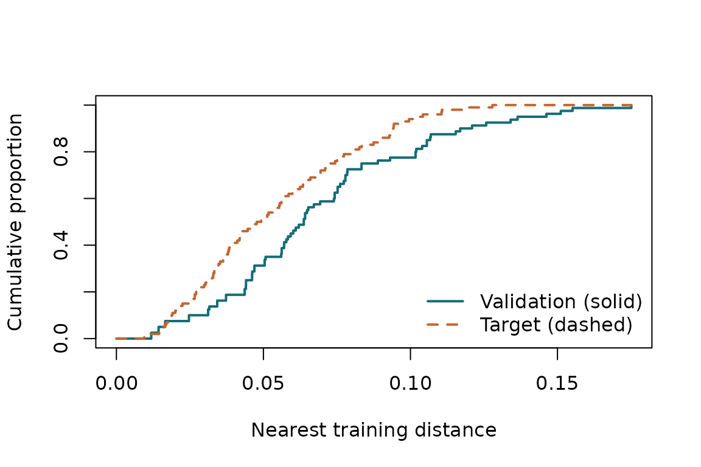

# Start with a spatial CV audit

Spatial CV should estimate prediction error for a particular task. Start
by specifying the locations at which you will make predictions and the
observations that will be available to fit the final model.

This tutorial uses simulated locations. No responses are needed to
compare distances. A specified or estimated covariance adds correlation
diagnostics.

## Define the prediction target

``` r

set.seed(42)
training <- matrix(runif(160), ncol = 2)
target_xy <- as.matrix(expand.grid(
  x = seq(0.05, 0.95, length.out = 10),
  y = seq(0.05, 0.95, length.out = 10)
))
target <- prediction_target(target_xy, label = "Grid inside the sampled region")
target
#> Grid inside the sampled region
#> 100 locations; equal weights
```

Each target location has equal weight here. Use `weights` for a target
whose locations have different importance. Weights describe the
prediction task; they should not be chosen after looking at which
predictions have small errors.

Numeric coordinates must share the same projected system and units. For
real geographic data, transform both sets of points to the same
appropriate projected CRS with
[`sf::st_transform()`](https://r-spatial.github.io/sf/reference/st_transform.html).
Longitude and latitude in degrees should not be passed as numeric
Euclidean coordinates.

## Construct a complete CV partition

``` r

folds <- spatial_folds(training, k = 5, method = "random", seed = 12)
vapply(folds, function(f) length(f$test), integer(1))
#> [1] 16 16 16 16 16
```

Every observation is held out once. Each fold supplies explicit `train`
and `test` indices. You can instead import a partition from your
modelling workflow:

``` r

imported <- cv_folds(rep(1:5, length.out = nrow(training)), nrow(training))
```

[`cv_folds()`](https://olatunjijohnson.github.io/spCVAudit/reference/cv_folds.md)
rejects missing test observations, overlapping training and test
indices, duplicates, and empty training sets. Buffered folds may leave
additional observations out of a training set.

## Compare nearest-training distances

``` r

audit <- audit_cv(training, folds, target)
audit
#> Spatial CV audit
#>           A           W          J1          J2          U1          U2 
#> -0.01568732  0.01578783          NA          NA          NA          NA 
#> Diagnostics compare prediction conditions; they do not certify CV accuracy.
plot(audit)
```



The **solid curve** describes the validation observations: each distance
is to the closest observation in that fold’s training set. The **dashed
curve** describes the target, using the complete training set. A curve
further left represents shorter nearest-training distances.

`W` measures the overall difference between the curves. `A` is mean
target distance minus mean validation distance. Positive `A` means
validation observations are closer to their available training
observations, on average.

## Add spatial correlation

``` r

covariance <- spatial_covariance(range = 0.2, signal = 0.8)
audit <- audit_cv(training, folds, target, covariance)
audit$diagnostics[c("W", "J1", "J2", "U1", "U2")]
#>           W          J1          J2          U1          U2 
#>  0.01578783 -0.04347391 -0.04958680  0.04384698  0.05014076
```

The exponential scale is 0.2 coordinate units. The spatial signal
fraction is 0.8; the other 0.2 of total variance is independent
observation noise. The correlation between distinct responses a distance
$`d`$ apart is $`\rho(d)=0.8\exp(-d/0.2)`$.

`J2` is average squared nearest-observation correlation during
validation minus the corresponding target average. A positive value
means higher average squared correlation during validation. Under the
paper’s one-neighbour Gaussian model, this indicates that CV
underestimates target MSE on average. For a different prediction model,
it describes a correlation mismatch, without establishing the direction
or size of its CV bias.

`U2` measures the discrepancy without cancellation. If `abs(J2)` is
small but `U2` is appreciably larger, positive and negative differences
cancel in `J2`.

## Compare alternative schemes

``` r

schemes <- list(
  random = folds,
  block = spatial_folds(training, 5, "block", seed = 12)
)
compare_cv_schemes(training, schemes, target, covariance, criterion = "J2")
#> CV comparison by |J2| 
#>  scheme          W         J2 criterion_value selection_probability
#>  random 0.01578783 -0.0495868       0.0495868                     1
#>   block 0.16292814 -0.2826897       0.2826897                     0
```

The result reports the probability assigned to each selected candidate.
It chooses the smallest `abs(J2)` and gives tied candidates equal
probabilities. Choosing `criterion = "W"` instead selects the closest
nearest-distance match. The selected CV scheme supplies an estimate of
target MSE; it does not change the final prediction model fitted to all
training observations.

Continue with
[`vignette("choosing-cv", package = "spCVAudit")`](https://olatunjijohnson.github.io/spCVAudit/articles/choosing-cv.md)
for weighted targets, buffered folds and tie handling, or
[`vignette("theory-and-limits", package = "spCVAudit")`](https://olatunjijohnson.github.io/spCVAudit/articles/theory-and-limits.md)
for the exact Gaussian results.
