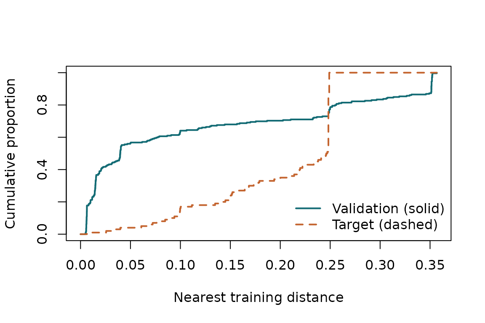

# Audit log-cadmium predictions in the Swiss Jura

The Jura soil survey measured trace-metal concentrations in Switzerland.
The public dataset distributed with **gstat** contains 259 original
training sites and 100 reserved validation sites. We predict natural-log
cadmium at those reserved sites. They define the target; their responses
are used only to evaluate the final predictions.

This tutorial uses one fold construction and the new package’s
covariance estimator. The [paper
repository](https://github.com/olatunjijohnson/spLeakage-paper) contains
the fixed fitting implementation, 40 fold constructions, alternative
targets and retained results used in the paper. Tutorial results are an
illustration, not a replacement for that complete reproduction.

Install `gstat` and `sf` to execute this tutorial. `CAST` adds the
optional kNNDM candidate. No data download or credentials are needed
once these packages are installed.

## Load the data and define the target

``` r

data("jura", package = "gstat")
train_sf <- sf::st_transform(
  sf::st_as_sf(jura.pred, coords = c("long", "lat"), crs = 4326), 2056)
target_sf <- sf::st_transform(
  sf::st_as_sf(jura.val, coords = c("long", "lat"), crs = 4326), 2056)

# Express projected distances in kilometres, using one common origin.
origin <- colMeans(sf::st_coordinates(train_sf))
xy <- sweep(sf::st_coordinates(train_sf), 2, origin) / 1000
qx <- sweep(sf::st_coordinates(target_sf), 2, origin) / 1000
y <- log(jura.pred$Cd)
observed_target <- log(jura.val$Cd)
target <- prediction_target(qx, label = "100 reserved Jura sites")
```

All prediction errors below are on the natural-log cadmium scale. Mean
squared error on this scale is not the same as error in the original
concentration units.

## Construct candidates and calculate diagnostics

``` r

nearest_other <- as.matrix(stats::dist(xy))
diag(nearest_other) <- Inf
buffer <- stats::median(apply(nearest_other, 1, min))

schemes <- list(
  random = spatial_folds(xy, 5, "random", seed = 52),
  block = spatial_folds(xy, 5, "block", seed = 52),
  buffered = spatial_folds(xy, 5, "buffered", buffer = buffer, seed = 52)
)
if (requireNamespace("CAST", quietly = TRUE)) {
  schemes$knndm <- spatial_folds(xy, 5, "knndm", target = target, seed = 52)
}

covariance <- estimate_covariance(xy, y)
covariance
#> Estimated exponential covariance
#>   scale: 0.3116873  signal: 0.7156111  total variance: 0.5171883 
#>   fit boundary: none
comparison <- compare_cv_schemes(xy, schemes, target, covariance, criterion = "J2")
comparison
#> CV comparison by |J2| 
#>    scheme          W          J2 criterion_value selection_probability
#>    random 0.11799010  0.15861849      0.15861849                     0
#>     block 0.51092277 -0.13175540      0.13175540                     0
#>  buffered 0.51092277 -0.13175540      0.13175540                     0
#>     knndm 0.03771657 -0.02950102      0.02950102                     1
plot(comparison$audits$random)
```



Inspect the fitted scale, signal fraction and boundary flags. Completion
of the fit does not establish that a covariance model adequately
describes the data. The common full-training estimate supplies the
diagnostic for every scheme.

## Make predictions without using target responses

We use ordinary kriging: an unknown constant mean, exponential spatial
covariance and independent observation noise. The helper below estimates
covariance using only the observations passed to it. `gstat` then
estimates the constant mean and makes the predictions.

``` r

predict_ordinary <- function(train_xy, train_y, new_xy) {
  fit <- estimate_covariance(train_xy, train_y)
  observations <- data.frame(x = train_xy[, 1], y = train_xy[, 2], z = train_y)
  new_points <- data.frame(x = new_xy[, 1], y = new_xy[, 2])
  variogram <- gstat::vgm(psill = fit$psill, model = "Exp",
                         range = fit$range, nugget = fit$nugget)
  model <- gstat::gstat(formula = z ~ 1, locations = ~ x + y,
                        data = observations, model = variogram)
  stats::predict(model, newdata = new_points, debug.level = 0)$var1.pred
}

target_predictions <- predict_ordinary(xy, y, qx)
target_mse <- mean((observed_target - target_predictions)^2)
target_mse
#> [1] 0.3217736
```

These predictions use all 259 training sites and are the same whichever
CV scheme is evaluated. The observed target MSE is an average of the 100
measured squared errors. It is not an expectation over repeated spatial
datasets.

## Refit inside each CV fold

``` r

cv_score <- function(folds) {
  predictions <- numeric(length(y))
  for (fold in folds) {
    predictions[fold$test] <- predict_ordinary(
      xy[fold$train, , drop = FALSE], y[fold$train],
      xy[fold$test, , drop = FALSE]
    )
  }
  mean((y - predictions)^2)
}

scores <- vapply(schemes, cv_score, numeric(1))
data.frame(scheme = names(scores), cv_mse = unname(scores),
            observed_target_mse = target_mse,
            absolute_discrepancy = abs(unname(scores) - target_mse))
#>     scheme    cv_mse observed_target_mse absolute_discrepancy
#> 1   random 0.2757051           0.3217736           0.04606848
#> 2    block 0.5434906           0.3217736           0.22171701
#> 3 buffered 0.5434906           0.3217736           0.22171701
#> 4    knndm 0.4433034           0.3217736           0.12152982
```

The closest CV score need not come from the scheme with the smallest `W`
or `abs(J2)`. Kriging uses all available observations, and each fold
also changes the data used to estimate its mean and covariance.
Nearest-distance matching alone does not match all these prediction
conditions.

Do not interpret one survey as establishing which scheme has the
smallest expected bias across repeated datasets. In the paper’s original
split, random CV is closer to observed target MSE than the
diagnostic-selected kNNDM. When the northernmost sites are reserved
instead, the selected block schemes are closer than random CV. The
intended target matters.

## Sources

The data are supplied by the `jura` dataset in **gstat**; no
measurements are bundled separately in spCVAudit. See the [gstat dataset
documentation](https://r-spatial.github.io/gstat/reference/jura.html).
The data retain their upstream terms and attribution.

Atteia, O., Dubois, J.-P. and Webster, R. (1994). Geostatistical
analysis of soil contamination in the Swiss Jura. *Environmental
Pollution*, 86, 315–327.

Goovaerts, P. (1997). *Geostatistics for Natural Resources Evaluation*.
Oxford University Press, Appendix C.
